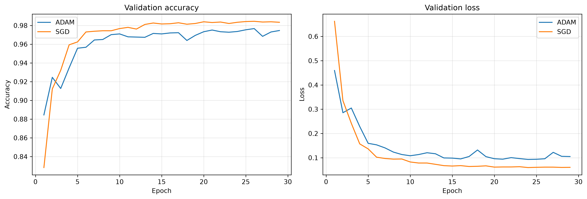
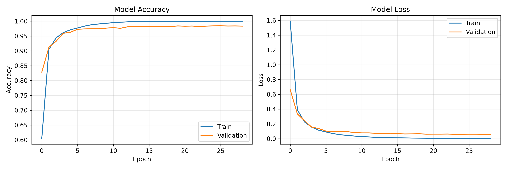
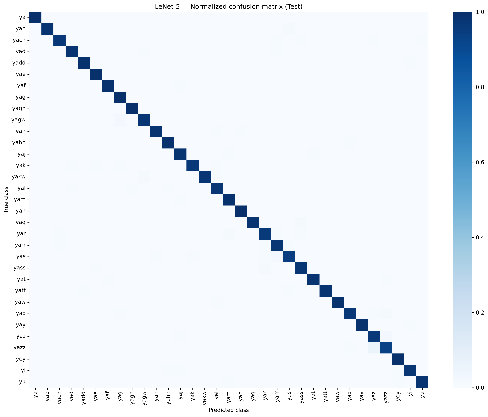
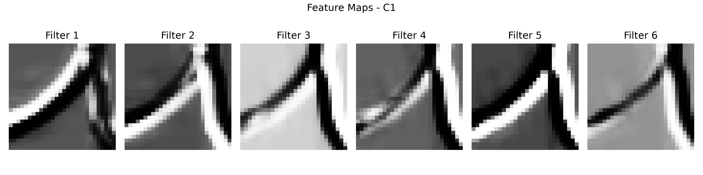
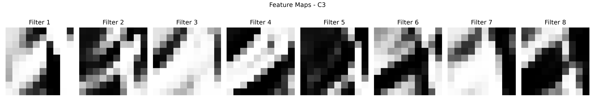
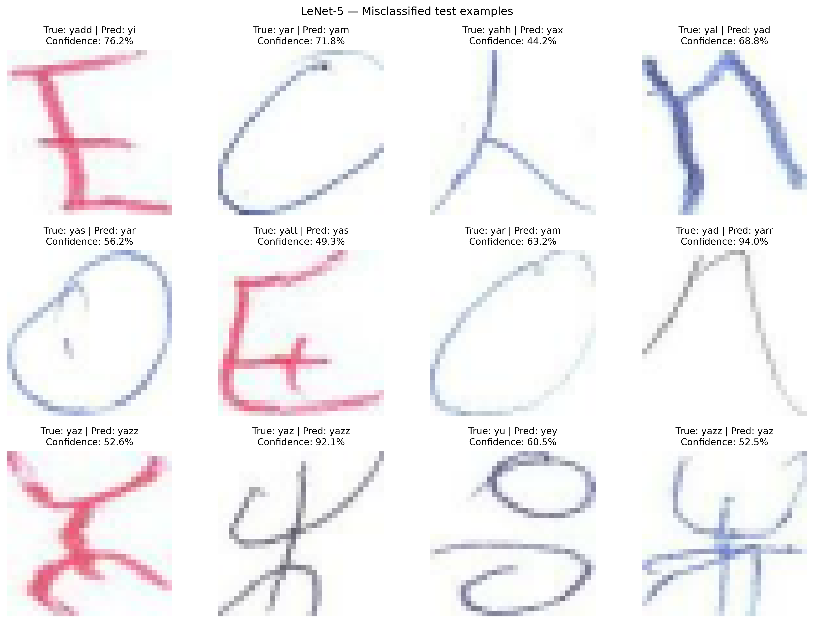

# LeNet-5 for Amazigh Handwritten Character Recognition

Implementation and evaluation of a **LeNet-5 convolutional neural network** for recognizing **33 handwritten Tifinagh characters** from the Amazigh Handwritten Character Database (AMHCD). This project was developed for the Deep Learning practical assignment (Master IAA).

## Results

| Metric | Result |
|---|---:|
| Test accuracy (selected SGD model) | **98.06%** |
| Test macro F1-score | **98.06%** |
| Correct / total test predictions | **3,786 / 3,861** |
| Best SGD validation accuracy | **98.34%** |
| Number of trainable parameters | **63,961** |

### Optimizer comparison

| Optimizer | Learning rate | Best epoch | Validation accuracy | Validation loss |
|---|---:|---:|---:|---:|
| Adam | 0.001 | 24 | 97.36% | 0.0930 |
| SGD (momentum = 0.9) | 0.01 | 24 | **98.34%** | **0.0595** |

The model was **selected using validation loss**, and the test set was reserved for final evaluation. These results are from one training run per optimizer, not a multi-seed benchmark.

## Dataset

**Source:** [AMHCD on Kaggle](https://www.kaggle.com/datasets/benaddym/amazigh-handwritten-character-database-amhcd)

- **25,740** images belonging to **33 classes** (780 images per class).
- Original images: **64 × 64 pixels, RGB**.
- Model input: **32 × 32 × 3 (RGB)**.
- Preprocessing: resizing and pixel scaling to **[0, 1]**.
- Stratified split: **70% training (18,018)**, **15% validation (3,861)**, **15% testing (3,861)**.
- Random seed: **42**.

Download the dataset from Kaggle, then place the character subfolders (e.g., `ya/`, `yab/`, `yach/`, ...) inside `data/AMHCD_64/`.

> The dataset is not included in this repository. The split is stratified **by image/class**; it is not established as writer-independent.

## Model architecture

| Layer | Output shape |
|---|---|
| Input (RGB) | 32 × 32 × 3 |
| C1 — Conv2D, 6 filters, 5 × 5 | 28 × 28 × 6 |
| S2 — AveragePooling2D, 2 × 2 | 14 × 14 × 6 |
| C3 — Conv2D, 16 filters, 5 × 5 | 10 × 10 × 16 |
| S4 — AveragePooling2D, 2 × 2 | 5 × 5 × 16 |
| Flatten | 400 |
| C5 — Dense | 120 |
| F6 — Dense | 84 |
| Output — Softmax | 33 |

Hidden layers use **tanh**, and training uses **sparse categorical cross-entropy**. The C5 stage is implemented using `Flatten` followed by `Dense(120)`, as a practical adaptation of LeNet-5. Layer-building functions and model hyperparameters can be adjusted in `src/model.py`.

## Project structure

```text
CNN-LENET-5/
├── data/                   # AMHCD dataset (not tracked by Git)
│   └── AMHCD_64/
├── notebooks/
│   └── LeNet5.ipynb        # Experiments, plots and final evaluation
├── src/
│   ├── dataset.py          # Dataset inspection, preprocessing, splits
│   ├── model.py            # Parametric LeNet-5 architecture
│   ├── train.py            # Training with Adam / SGD
│   └── evaluate.py         # Metrics, confusion matrix, feature maps
├── results/                # Trained models, CSV/JSON metrics, figures
├── .gitignore
└── README.md
```

## Installation

From the project root, create and activate a virtual environment:

```bash
python3 -m venv .venv
source .venv/bin/activate            # macOS / Linux
python -m pip install --upgrade pip
pip install tensorflow numpy pandas matplotlib seaborn scikit-learn pillow jupyter ipykernel
```

Use a Python/TensorFlow combination supported on your operating system. In VS Code, select the `.venv` interpreter and Jupyter kernel.

## How to run

All commands below should be run **from the project root**.

**1. Check the dataset**

```bash
python src/dataset.py
```

**2. Inspect the network**

```bash
python src/model.py
```

**3. Train the models**

```bash
python src/train.py --optimizer both --epochs 30
```

To train only one optimizer:

```bash
python src/train.py --optimizer adam --epochs 30
python src/train.py --optimizer sgd --epochs 30
```

Training uses a batch size of **32**, validation-based checkpointing, and early stopping (patience = 5). Best models are saved to `results/lenet5_adam.keras` and `results/lenet5_sgd.keras`.

**4. Run the notebook**

Open `notebooks/LeNet5.ipynb` in VS Code, select the `.venv` kernel and use **Run All**. The notebook expects the trained model and history files inside `results/`; by default, `RUN_TRAINING = False` avoids retraining. Set it to `True` only if you want to train again.

## Visualizations

### Optimizer comparison



### Training curves



### Confusion matrix



### Learned feature maps





### Misclassified examples



## Discussion and limitations

The trained LeNet-5 model correctly classifies most test images. Errors concentrate in a small set of visually similar handwritten characters, including **`yaz` / `yazz`** and **`yar` / `yam`**. In this run, SGD had better validation results than Adam; this does not establish that SGD is universally superior.

The current evaluation uses a **stratified image-level split**. If writer identities are available, a writer-independent split would provide a stronger assessment of generalization to unseen handwriting styles.

## Reference

Y. LeCun, L. Bottou, Y. Bengio and P. Haffner, “Gradient-Based Learning Applied to Document Recognition,” *Proceedings of the IEEE*, vol. 86, no. 11, pp. 2278–2324, 1998.

**Repository:** https://github.com/Ben10-L/CNN-LENET-5
