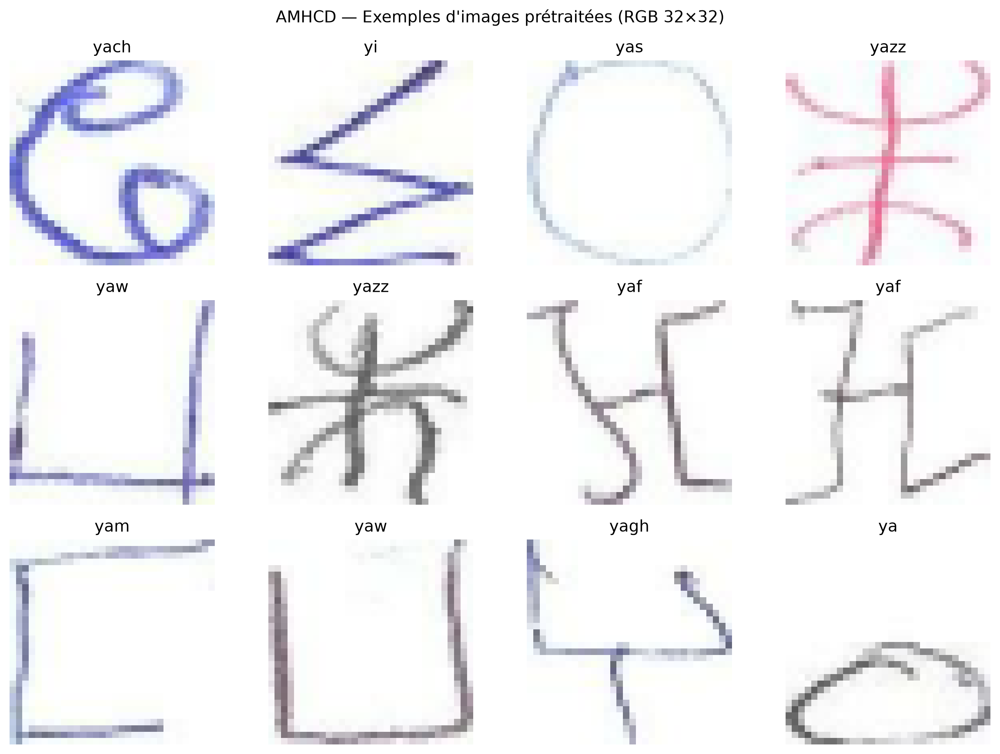

# LeNet-5 for Amazigh Handwritten Character Recognition

<p align="center">
  <strong>Handwritten Tifinagh classification with a compact convolutional neural network</strong><br>
  An end-to-end TensorFlow/Keras implementation, from data preparation to model evaluation.
</p>

<p align="center">
  
  
  
  
  
</p>

---

## Overview

This project implements and evaluates a **LeNet-5-inspired convolutional neural network (CNN)** for classifying **33 handwritten Amazigh (Tifinagh) characters** using the **Amazigh Handwritten Character Database (AMHCD)**. It follows an experimental machine-learning workflow: dataset inspection, preprocessing, stratified splitting, model construction, training with two optimizers, and quantitative and qualitative evaluation.

The implementation uses **RGB inputs** and modular, configurable layer-building functions. The repository includes Python source files, a Jupyter notebook, training histories, and visualizations intended to support reproducibility and scientific reporting.

**Dataset:** [Amazigh Handwritten Character Database (AMHCD) — Kaggle](https://www.kaggle.com/datasets/benaddym/amazigh-handwritten-character-database-amhcd)

## Key results

The checkpoint selected by **minimum validation loss** was trained with **SGD (momentum = 0.9)**. The held-out test set was used for final evaluation, not for optimizer selection.

| Test-set metric | Result |
|:--|--:|
| **Accuracy** | **98.06%** |
| **Macro F1-score** | **98.06%** |
| Correct predictions | 3,786 / 3,861 |
| Incorrect predictions | 75 / 3,861 |
| Number of classes | 33 |
| Trainable model parameters | 63,961 |

### Optimizer benchmark

Both models use the same architecture and data split. The learning rates and SGD momentum are specified explicitly below.

| Optimizer | Learning rate | Best epoch | Validation accuracy | Validation loss |
|:--|--:|--:|--:|--:|
| Adam | 0.001 | 24 | 97.36% | 0.0930 |
| **SGD + momentum (0.9)** | **0.01** | **24** | **98.34%** | **0.0595** |

SGD performed better **in this configuration and single run**. This does not establish that SGD is generally superior to Adam; a controlled multi-seed, hyperparameter-matched benchmark would be needed for a stronger comparison.


## Dataset and preprocessing

| Property | Value |
|:--|:--|
| Dataset | AMHCD |
| Total images | 25,740 |
| Classes | 33 Tifinagh characters |
| Images per class | 780 |
| Original image format | RGB, 64 × 64 pixels |
| Network input | RGB, 32 × 32 × 3 |
| Pixel normalization | Divide by 255, resulting in values in [0, 1] |
| Random seed | 42 |

The images are split using **stratified random sampling** so that each class is represented proportionally:

| Split | Percentage | Images | Images per class |
|:--|--:|--:|--:|
| Training | 70% | 18,018 | 546 |
| Validation | 15% | 3,861 | 117 |
| Test | 15% | 3,861 | 117 |
| **Total** | **100%** | **25,740** | **780** |

Preprocessing is applied at load time via `tf.data`; source images are not overwritten.



> **Evaluation scope:** Stratification is by **image/class**, not by writer identity. Writer-independent generalization has **not** been demonstrated by this split.

## Network architecture

The model retains the principal stages of LeNet-5 while accepting three-channel RGB images and producing probabilities for 33 classes. Hidden layers use `tanh`; the final classification layer uses `softmax`.

| Stage | Configuration | Output shape | Trainable parameters |
|:--|:--|:--|--:|
| Input | RGB image | 32 × 32 × 3 | — |
| C1 | Conv2D, 6 filters, 5 × 5, valid padding | 28 × 28 × 6 | 456 |
| S2 | AveragePooling2D, 2 × 2 | 14 × 14 × 6 | 0 |
| C3 | Conv2D, 16 filters, 5 × 5, valid padding | 10 × 10 × 16 | 2,416 |
| S4 | AveragePooling2D, 2 × 2 | 5 × 5 × 16 | 0 |
| Flatten | Flatten feature maps | 400 | 0 |
| C5 | Dense, 120 units | 120 | 48,120 |
| F6 | Dense, 84 units | 84 | 10,164 |
| Classifier | Dense, 33 units, softmax | 33 | 2,805 |
| **Total** | | | **63,961** |

The C5 stage is implemented as `Flatten` followed by `Dense(120)`—a practical dense-layer adaptation rather than the original convolutional C5 formulation. The model and layer parameters can be changed in [`src/model.py`](src/model.py).

**Training configuration:** sparse categorical cross-entropy; batch size 32; up to 30 epochs; best-checkpoint selection based on validation loss; early stopping with patience 5.

## Repository layout

```text
CNN-LENET-5/
├── data/                       # Downloaded dataset (excluded from Git)
│   └── AMHCD_64/               # One folder per Tifinagh class
├── notebooks/
│   └── LeNet5.ipynb            # Experiments, analysis and plots
├── src/
│   ├── dataset.py              # Dataset checks, preprocessing and splits
│   ├── model.py                # Parametric LeNet-5 model
│   ├── train.py                # Adam / SGD training and checkpoints
│   └── evaluate.py             # Evaluation metrics and feature maps
├── results/                    # Checkpoints, metrics and exported figures
├── .gitignore
└── README.md
```

## Quick start

### 1. Clone and set up the environment

```bash
git clone https://github.com/Ben10-L/CNN-LENET-5.git
cd CNN-LENET-5
python3 -m venv .venv
source .venv/bin/activate  # macOS / Linux
python -m pip install --upgrade pip
python -m pip install tensorflow numpy pandas matplotlib seaborn scikit-learn pillow jupyter ipykernel
```

Use a **Python version supported by your TensorFlow release**. In VS Code, select `.venv` as both the Python interpreter and notebook kernel.

### 2. Download the dataset

Download [AMHCD from Kaggle](https://www.kaggle.com/datasets/benaddym/amazigh-handwritten-character-database-amhcd) and place the class directories directly under `data/AMHCD_64/`:

```text
data/AMHCD_64/
├── ya/
├── yab/
├── yach/
├── ...
└── yu/
```

The dataset is intentionally **not included** in this repository.

### 3. Verify data and model

Run all commands from the **repository root**:

```bash
python src/dataset.py
python src/model.py
```

The dataset check should report **33 classes and 25,740 images**; the model summary should report **63,961 parameters**.

### 4. Train

```bash
# Compare both optimizers
python src/train.py --optimizer both --epochs 30

# Or train separately
python src/train.py --optimizer adam --epochs 30
python src/train.py --optimizer sgd --epochs 30
```

You can also change the batch size or learning rate:

```bash
python src/train.py --optimizer sgd --epochs 30 --batch-size 32 --lr 0.01
```

Best checkpoints and training logs are written to `results/`.

### 5. Run the evaluation notebook

Open [`notebooks/LeNet5.ipynb`](notebooks/LeNet5.ipynb), select the `.venv` kernel and choose **Run All**.

The notebook loads the saved histories and model checkpoints, compares optimizers, evaluates the selected model on the test set, and generates figures. With `RUN_TRAINING = False`, it expects the necessary checkpoints and histories to already exist in `results/`. **Run training first if those files are absent.**

## Evaluation and visualizations

### Learning curves

Training and validation accuracy/loss help assess convergence and possible overfitting.


### Normalized confusion matrix

Rows represent true labels and columns represent predicted labels. The strong diagonal indicates high classification accuracy across most of the 33 classes.


### Learned feature representations

The following feature maps illustrate how the first and second convolutional layers respond to one input character. C1 retains more local stroke and edge information, while C3 combines earlier responses into higher-level patterns.

**C1 — first convolutional layer**


**C3 — second convolutional layer**


### Error analysis

Misclassified examples expose visually ambiguous characters and high-confidence mistakes. For example, the model sometimes confuses `yaz` with `yazz`, or `yar` with `yam`.


Additional per-class precision, recall and F1-scores are available in [`results/per_class_metrics.csv`](results/per_class_metrics.csv).

## Generated artifacts

| Artifact | Purpose |
|:--|:--|
| `results/lenet5_adam.keras` | Best Adam checkpoint |
| `results/lenet5_sgd.keras` | Best SGD checkpoint |
| `results/history_adam.csv` / `.json` | Adam training logs |
| `results/history_sgd.csv` / `.json` | SGD training logs |
| `results/validation_comparison.csv` | Validation comparison table (notebook output) |
| `results/per_class_metrics.csv` | Test precision, recall, F1 and support by class |
| `results/confusion_matrix.png` | Absolute test-set confusion matrix |
| `results/confusion_matrix_normalized.png` | Row-normalized test confusion matrix |
| `results/optimizer_comparison.png` | Validation curves for both optimizers |
| `results/feature_maps_C1.png` / `feature_maps_C3.png` | Learned convolutional activations |
| `results/misclassified_examples.png` | Examples of classification errors |

Some exported figures and tables are created when the notebook is executed. Files appear in GitHub only after they have been committed to the repository.

## Reproducibility and limitations

- **Selection protocol:** model selection uses **validation loss**; test results are reported only for final evaluation.
- **Single-run comparison:** results are from one seeded experiment per optimizer. Differences may change with initialization, split, or tuning.
- **Different optimizer settings:** Adam and SGD use different learning rates, and SGD additionally uses momentum; this is a practical comparison rather than a matched hyperparameter study.
- **Writer overlap:** the provided random image split does not guarantee separation of writers between training and test data.
- **Generalization:** accuracy on AMHCD does not, on its own, establish performance on new writers, devices, or external datasets.

These points should be considered when interpreting the reported **98.06% test accuracy**.

## References

1. Y. LeCun, L. Bottou, Y. Bengio and P. Haffner, *Gradient-Based Learning Applied to Document Recognition*, Proceedings of the IEEE, 86(11), 2278–2324 (1998). [DOI: 10.1109/5.726791](https://doi.org/10.1109/5.726791).
2. [AMHCD: Amazigh Handwritten Character Database, Kaggle](https://www.kaggle.com/datasets/benaddym/amazigh-handwritten-character-database-amhcd).

---

<p align="center"><sub>Developed as a Deep Learning coursework project · Amazigh handwritten character recognition</sub></p>
